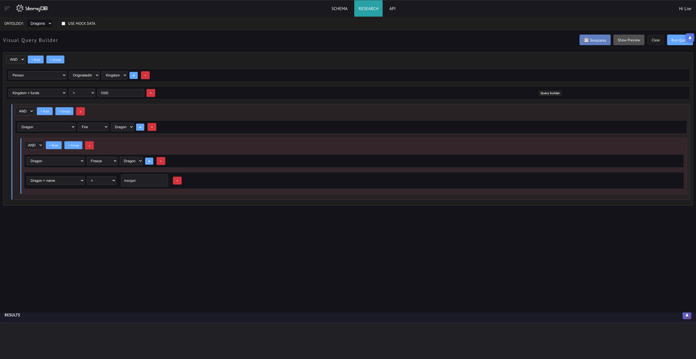
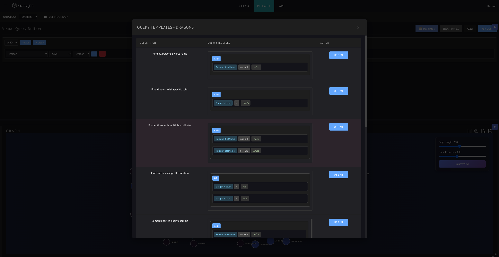
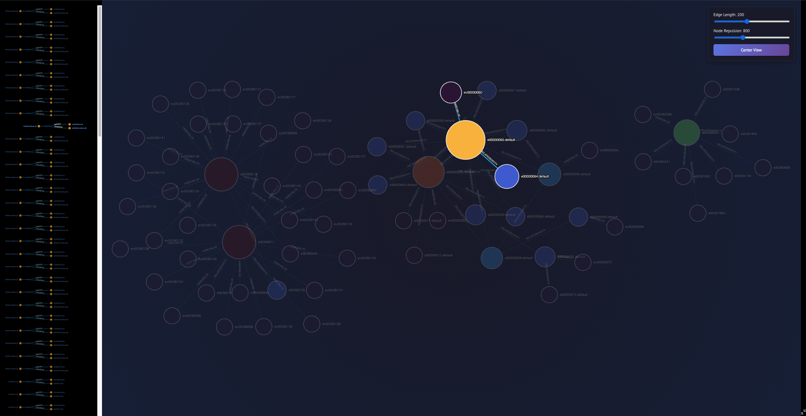
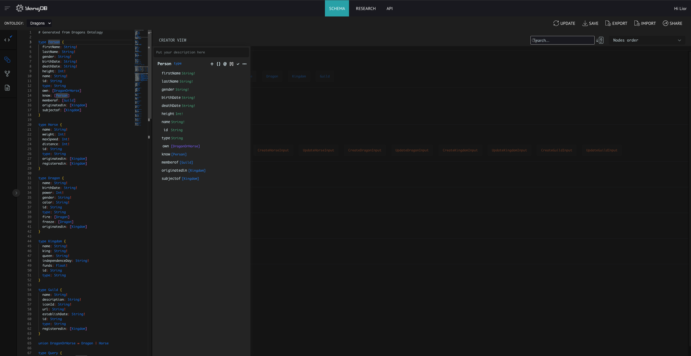
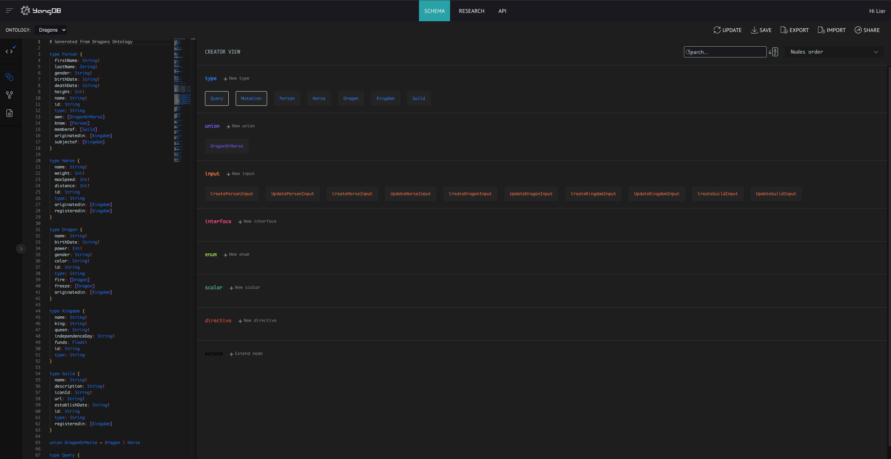
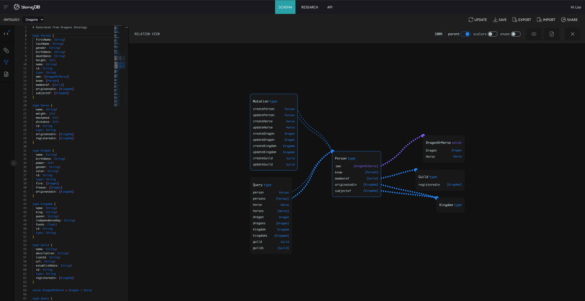
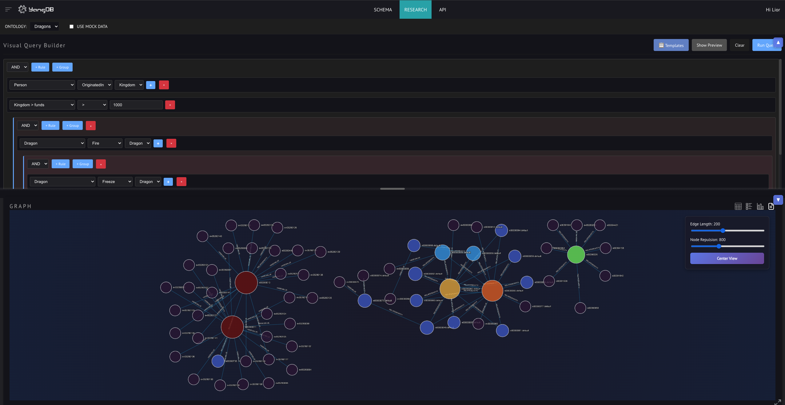
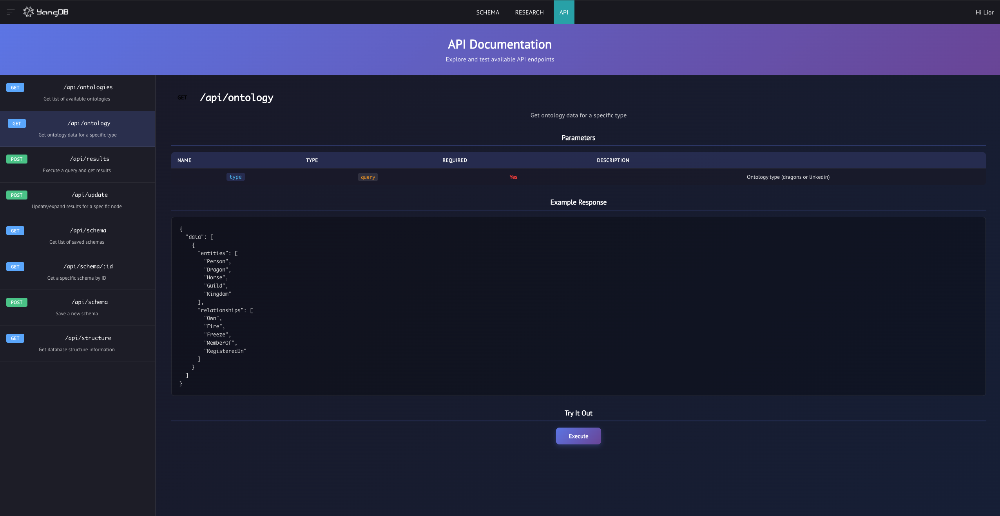

# web-ui

User interface for graph database interaction and ontology management

## Quick Start

Run `yarn` to install dependencies, followed by `yarn start`.

The application will be available at `http://localhost:3000`

## Features Overview

The YangDB user interface provides a comprehensive platform for graph database interaction, visual query building, and schema management.

### 🔍 Visual Query Builder

Build complex graph queries without writing code using an intuitive drag-and-drop interface.

**Key Features**:
- **Multi-Ontology Support**: Switch between Dragons and LinkedIn ontologies
- **Query Templates**: Pre-built query examples for common patterns (9 Dragons, 10 LinkedIn templates)
- **Relationship-Based Querying**: Select entities and traverse relationships visually
- **Nested Query Patterns**: Build multi-level relationship queries with visual nesting
- **Query Preview**: View generated queries in JSON, GraphQL, or Cypher format
- **Property Filtering**: Add conditions on entity properties
- **Relationship Expansion**: Click "+" to explore relationship targets
- **Mock Data Mode**: Test queries with generated sample data when backend is unavailable
- **Collapsible Panels**: Minimize query builder or results to maximize workspace


*Query builder with template selector and mock data toggle*


*Pre-built query templates with visual preview*


*Detailed graph visualization with entity connections*
📖 [Full Documentation](docs/VISUAL_QUERY_BUILDER.md)

---

### 📊 Schema Viewer

View and manage GraphQL schemas for different ontologies.

**Key Features**:
- **Ontology Selection**: Switch between Dragons and LinkedIn schemas
- **GraphQL Schema Display**: Syntax-highlighted schema viewer
- **Auto-Generated Types**: Entity types, relationships, and properties
- **Schema Validation**: Real-time syntax checking
- **Export/Import**: Share and backup schemas
- **Graph Visualization**: Interactive entity relationship diagrams


*Entity type viewer showing Person attributes and relationships*


*Detailed field definitions for entity types*


*Visual graph representation of entity relationships*


📖 [Full Documentation](docs/SCHEMA_VIEWER.md)

---

### 📊 Results Visualization

View query results in multiple interactive formats with rich visualization options.

**View Modes**:
- **Graph View**: Interactive network visualization using Cytoscape.js
  - Node size based on connectivity
  - Color gradient showing relationship density
  - Click to expand/collapse nodes
  - Adjustable edge length and node repulsion
  - Center view button for easy navigation
  - Full-screen mode for detailed exploration
- **Table View**: Tabular display grouped by entity type
  - Columns for all entity properties
  - Sortable and filterable data
  - Grouped by entity type with counts
- **List View**: Card-based layout with entity details
  - Scrollable entity cards
  - Properties displayed in grid format
  - Grouped by entity type
  - Color-coded value types
- **JSON View**: Raw data inspection
  - Collapsible/expandable tree structure
  - Syntax highlighting by data type
  - Copy to clipboard
  - Download as JSON file
  - Expand/collapse all controls

**Interactive Controls**:
- **Collapse Panels**: Minimize query builder or results for focused work
- **View Switcher**: Quick toggle between graph/table/list/JSON views
- **Graph Controls**: Adjust layout parameters in real-time
- **Maximize Graph**: Full-screen graph view with menu overlay


*Complete research interface showing query builder, results visualization, and multiple view modes*

---

### 📡 API Documentation

Interactive API documentation with a Swagger-like interface for exploring and testing endpoints.

**Key Features**:
- **Endpoint Browser**: List of all available API endpoints
- **HTTP Method Color Coding**: Visual distinction for GET, POST, PUT, DELETE
- **Parameter Documentation**: Detailed parameter definitions with types and requirements
- **Request/Response Examples**: Sample JSON payloads for each endpoint
- **Try It Out**: Interactive testing directly from the documentation
- **Real-time Execution**: Test API calls and view responses inline

**Available Endpoints**:
- `GET /api/ontologies` - List available ontologies
- `GET /api/ontology?type={type}` - Get ontology data
- `POST /api/results` - Execute queries
- `POST /api/update` - Expand results for specific nodes
- `GET /api/schema` - List saved schemas
- `GET /api/schema/:id` - Get specific schema
- `POST /api/schema` - Save new schema
- `GET /api/structure` - Get database structure


*Swagger-like API documentation interface with interactive endpoint testing*

---


## Ontology Support

The application supports multiple ontologies for different data domains:

### Dragons Ontology
A fantasy-themed ontology for game or storytelling applications.

**Entities**: Person, Dragon, Horse, Guild, Kingdom

**Relationships**: Own, Fire, Freeze, MemberOf, RegisteredIn

### LinkedIn Ontology
A professional networking ontology for social and business data.

**Entities**: Person, Company, Position, School, Education, Skill, Post, Group

**Relationships**: WorksAt, HasPosition, ConnectedTo, Follows, StudiedAt, HasSkill, Endorses, Published, Liked, Commented, MemberOf, Recommends

---

## Application Architecture

### Frontend (React)
- **Pages**: Schema, Research, API, Analytics, Report, Monitoring, Management
- **Components**:
  - `VisualQueryBuilder` - Query building interface with templates
  - `Results` - Multi-view results display
  - `Force` - Cytoscape.js graph visualization
  - `Table` - Tabular entity data display
  - `EntityList` - Card-based entity list
  - `JsonView` - Interactive JSON tree viewer
  - `QueryTemplates` - Pre-built query template modal
  - `GraphQLEditor` - Schema editor
- **State Management**: Redux for query history and results
- **Styling**: CSS Modules with custom theming
- **Visualization**: Cytoscape.js for network graphs
- **Mock Data**: Client-side graph data generators for offline testing

### Backend (Node.js/Express)
- **API Endpoints**:
  - `/api/ontology?type={type}` - Get ontology data
  - `/api/ontologies` - List available ontologies
  - `/api/results` - Execute queries
  - `/api/schema` - Manage schemas
- **Data Storage**: Mock data in `/mocks/ontology/` directory

### Key Technologies
- **React 18** - UI framework
- **Redux** - State management
- **Cytoscape.js** - Graph visualization (replaced D3.js)
- **react-querybuilder v8** - Visual query builder
- **re-resizable** - Resizable panels
- **CSS Modules** - Scoped styling

---

## Key Workflows

### Building a Query

1. Navigate to **Research** tab
2. Select an ontology from the dropdown (Dragons or LinkedIn)
3. **Option A - Use Template**:
   - Click **Templates** button
   - Browse pre-built query examples
   - Select a template to load it into the builder
4. **Option B - Build Custom Query**:
   - Click **+ Rule** to add query conditions
   - Select entity → relationship → target entity
   - Click **+** button to expand relationships
   - Add property filters as needed
5. Click **Show Preview** to view generated query
6. Toggle **Use Mock Data** to test with sample data
7. Click **Run Query** to execute

### Viewing Results

1. After executing a query, results appear in the lower panel
2. Choose from 4 view modes using the toolbar:
   - **Graph** (default): Interactive network visualization
     - Drag nodes to rearrange layout
     - Adjust **Edge Length** and **Node Repulsion** sliders
     - Click **Center View** to fit all nodes
     - Click maximize button for full-screen view
   - **Table**: Spreadsheet-style view grouped by entity type
   - **List**: Scrollable cards showing entity details
   - **JSON**: Raw data with syntax highlighting
3. **Collapse panels** to maximize workspace:
   - Click ▲ on query builder to collapse upward
   - Click ▼ on results to collapse downward
4. Export data using JSON view controls

### Viewing Schema

1. Navigate to **Schema** tab
2. Select an ontology from the dropdown
3. View the auto-generated GraphQL schema
4. Explore entity types and relationships
5. Use actions menu to export/share

### Exploring API Documentation

1. Navigate to **API** tab
2. Browse the list of available endpoints on the left
3. Click any endpoint to view details:
   - HTTP method and path
   - Parameter definitions and requirements
   - Example request body (for POST requests)
   - Example response structure
4. Use "Try It Out" to test endpoints:
   - Edit the request body JSON for POST requests
   - Click "Execute" to send the request
   - View the response status and data inline

---

## Documentation

### User Guides
- [Visual Query Builder Guide](docs/VISUAL_QUERY_BUILDER.md) - Complete query building documentation
- [Schema Viewer Guide](docs/SCHEMA_VIEWER.md) - Schema management and ontology structure
- [Results Visualization Guide](docs/RESULTS_VISUALIZATION.md) - Using graph, table, list, and JSON views
- [Query Templates Guide](docs/QUERY_TEMPLATES.md) - Pre-built query examples and patterns

### Technical Documentation
- [Cytoscape.js Integration](docs/CYTOSCAPE_INTEGRATION.md) - Network graph visualization with Cytoscape.js
- [Mock Data Generators](docs/MOCK_DATA.md) - Client-side data generation for testing
- [Connectivity Visualization](docs/CONNECTIVITY_VISUALIZATION.md) - Node sizing and coloring based on connections
- [Relationship Patterns](RELATIONSHIP_PATTERNS.md) - Understanding relationship patterns

### Development
- [GitHub Actions Setup](GITHUB_ACTIONS_SETUP.md) - CI/CD configuration
- [Workflows Summary](WORKFLOWS_SUMMARY.md) - Automation workflows
- [Component Architecture](docs/COMPONENTS.md) - React component structure and patterns

---

## Development

### Project Structure
```
web-ui/
├── client/               # React frontend
│   ├── src/
│   │   ├── components/   # Reusable React components
│   │   ├── pages/        # Page components
│   │   ├── services/     # API services
│   │   └── helpers/      # Utility functions
│   └── public/
├── mocks/               # Mock data
│   └── ontology/        # Ontology definitions
│       ├── dragons/
│       └── linkedin/
├── server.js            # Express backend
└── docs/                # Documentation
```

### Available Scripts

- `yarn start` - Start development server
- `yarn build` - Build for production
- `yarn test` - Run test suite
- `yarn lint` - Lint code

---

## Contributing

When adding new features:
1. Update relevant documentation in `/docs`
2. Add screenshots to `/docs/images`
3. Update this README if needed
4. Ensure tests pass
5. Follow existing code style

---

## Screenshots

All screenshots are available in `/docs/images`:

### Research Page
- `research-visual-query-builder.png` - Query builder interface with ontology selector and controls
- `research-template-queries.png` - Pre-built query templates modal
- `research-results.png` - Complete research interface with query builder and results visualization

### Schema Viewer
- `schema-person.png` - Entity type viewer showing Person attributes and relationships
- `schema-fields.png` - Detailed field definitions for entity types
- `schema-person-graph.png` - Visual graph representation of entity relationships
- `schema-graph-results-details.png` - Detailed graph visualization with entity connections

### API Documentation
- `api-swagger.png` - Swagger-like API documentation interface

### Dashboard
- `dashboard-overview.png` - Main analytics dashboard overview

---

## License

[Add your license information here]
