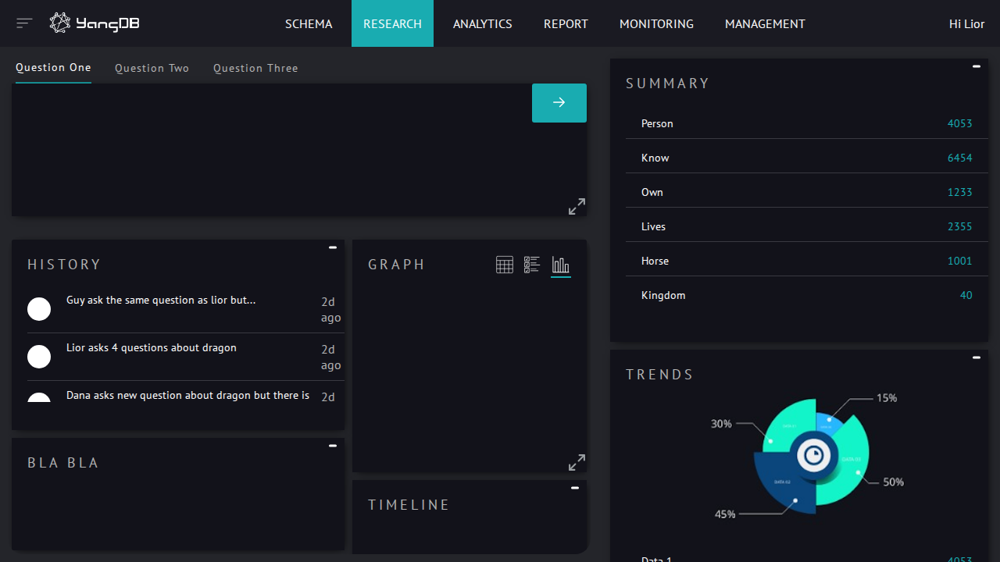

# web-ui

User interface to interact

## Instructions

Run `yarn` to install dependencies, followed by `yarn start`.

## Features

The YangDB user interface provides a comprehensive dashboard for interacting with your data. The main components of the interface are:

- **Navigation Bar**: Located at the top of the page, the navigation bar provides access to the different sections of the application, including Schema, Research, Analytics, Report, Monitoring, and Management.

- **Query Interface**: The main section of the Research tab allows users to input and submit queries. It includes a tabbed interface for managing multiple questions.

- **Summary View**: On the right side of the dashboard, the Summary view displays a high-level overview of key data points, such as the number of "Person", "Know", "Own", "Lives", "Horse", and "Kingdom" entities.

- **History Panel**: This panel shows a log of recent queries and interactions, allowing users to track their activity.

- **Graph, Timeline, and Trends**: The central area of the dashboard features several visualizations:
    - The **Graph** panel provides a graphical representation of the data.
    - The **Timeline** view shows events and data points over time.
    - The **Trends** panel displays a pie chart that breaks down data into key percentages.

