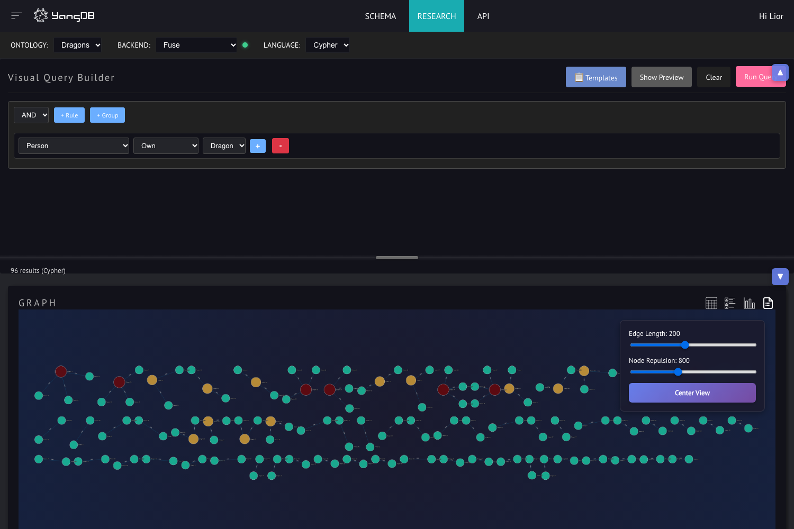
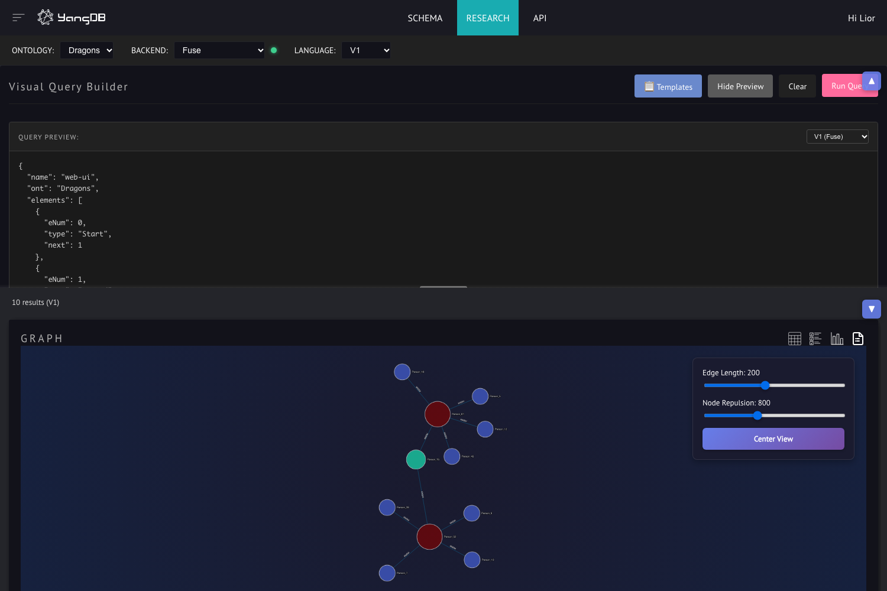
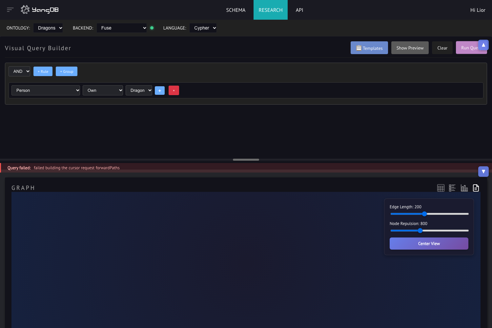

# Tutorial: the Dragons graph, from Docker to answers

This walks through one complete use case: start a YangDB (Fuse) graph server, load the Dragons sample world into it,
and question it from web-ui, first with templates and then with your own queries, in Cypher and in V1. It ends with
the same queries over plain HTTP and the automated checks that keep all of this working.

Allow about 15 minutes. Every number below comes from the Dragons sample as loaded by step 2, with Fuse 0.9.1.

## What you need

- Docker (Docker Desktop on macOS or Windows), with about 3 GB of free memory and 3 GB of disk for the images
- Node.js 20 or newer, and Yarn 1 (`npm install -g yarn`)
- `git` and `curl`

## 1. Get web-ui

```bash
git clone https://github.com/YANG-DB/web-ui.git
cd web-ui
yarn            # installs the mock server and, through postinstall, the client
```

## 2. Start Fuse and load the Dragons world

```bash
scripts/fuse-up.sh
```

The script:

1. starts OpenSearch 2.19.7 on port 9200 (single node, security off, for local use only);
2. starts Fuse from the published image `ghcr.io/yang-db/yang.db:0.9.1` on port 8888, configured for that
   OpenSearch;
3. calls `POST /fuse/dragons/tutorial/load`, which creates the Dragons ontology, its indices and loads every CSV file
   of the sample.

The first run downloads the images and takes a few minutes; later runs take about 30 seconds. If a Fuse is already
answering on port 8888 (for example the one from yang-db's `docker compose`), the script reuses it and only loads
the data.

Check it:

```bash
curl http://localhost:8888/fuse/health
# "Alive And Well..."
curl -s http://localhost:8888/fuse/catalog/ontology/Dragons | head -c 200
```

### The Dragons world

| Entity | Some properties |
|---|---|
| Person | firstName, lastName, gender (`MALE`, `FEMALE`), birthDate, height |
| Dragon | name, color (`BLACK`, `RED`, `BLUE`, ...), gender, power |
| Horse | name, weight, maxSpeed, distance |
| Kingdom | name, king, queen, funds, independenceDay |
| Guild | name, description, establishDate, url |

| Relationship | From | To |
|---|---|---|
| Own | Person | Dragon, Horse |
| Know | Person | Person |
| MemberOf | Person | Guild |
| Fire, Freeze | Dragon | Dragon |
| OriginatedIn | Dragon, Horse, Person | Kingdom |
| RegisteredIn | Guild, Horse | Kingdom |
| SubjectOf | Person | Kingdom |

Values are case-sensitive: dragons are `BLACK`, not `black`. A query for `black` runs fine and returns nothing.

## 3. Start web-ui

```bash
yarn start
```

This starts the mock server (port 5001) and the React app (port 3000), and opens http://localhost:3000. Open
**Research**.

The toolbar shows **Backend: Fuse** with a green dot: the app found Fuse through the dev proxy (`/fuse` goes to
`http://localhost:8888`, see the README's Backends section). If the dot is red, see Troubleshooting.

## 4. Run a template

1. Click **📋 Templates** and **Use Me** next to "Find dragons owned by persons (relationship)". The builder shows one rule:
   `Person` `Own` `Dragon`.
2. Click **Run Query**.

The status line reads **96 results (Cypher)** and the graph shows people linked to the dragons they own.



Each result is one *assignment*: one person, one dragon and the `Own` relationship between them. The table, list and
JSON buttons above the graph show the same result in other forms.

Every template returns results from the sample:

| # | Template | Rows (Cypher and V1) |
|---|---|---|
| 0 | Find all persons by first name | 100 (first page) |
| 1 | Find dragons with specific color (`BLACK`) | 100 of 121 |
| 2 | Find entities with multiple attributes | 100 (first page) |
| 3 | Find entities using OR condition (`RED` or `BLUE`) | 100 (first page) |
| 4 | Complex nested query example | 100 (first page) |
| 5 | Find dragons owned by persons | 96 |
| 6 | Find persons who are members of guilds | 83 |
| 7 | Find persons who know someone named Christiana | 10 |
| 8 | Persons with a black dragon that fired on a dragon, and a horse from a funded kingdom | 100 (first page) |

## 5. Page through a large result

Run template 1, "Find dragons with specific color". There are 121 black dragons, but Fuse returns pages of 100, so
the status line reads **100 results** with a **Load more** button. Click it: the next page is added to the graph and
the line reads **121 results**. The button disappears when a page comes back short.

## 6. Cypher or V1

web-ui sends your query to Fuse in one of two languages; pick it in **Language**.

- **Cypher** is the familiar text language. Fuse supports a subset of it.
- **V1** is Fuse's own JSON query language, which Fuse runs without translation. Everything the builder can express
  as a single connected pattern, V1 can run.

To see what is sent, click **Show Preview** and pick **Cypher (Fuse)** or **V1 (Fuse)**. For template 7:

```cypher
MATCH (p:Person)-[r0:Know]->(p1:Person)
WHERE p1.firstName = 'Christiana'
RETURN p, r0, p1
```

```json
{ "name": "web-ui", "ont": "Dragons", "elements": [
  { "eNum": 0, "type": "Start", "next": 1 },
  { "eNum": 1, "type": "ETyped", "eTag": "p", "eType": "Person", "next": 2 },
  { "eNum": 2, "type": "Rel", "rType": "Know", "dir": "R", "next": 3 },
  { "eNum": 3, "type": "ETyped", "eTag": "p1", "eType": "Person", "next": 4 },
  { "eNum": 4, "type": "EProp", "pType": "firstName",
    "con": { "type": "Constraint", "op": "eq", "expr": "Christiana" } }
]}
```



Both return the same 10 rows. Where they differ:

| | Cypher | V1 |
|---|---|---|
| contains, begins with, ends with | `CONTAINS` fails on Fuse 0.9.1 | sent as `like` with `*` wildcards, works |
| OR across two different entities (`p.gender = 'MALE' OR d.color = 'RED'`) | works | not expressible: V1 groups conditions per entity. web-ui says so instead of running it |
| patterns that are not connected | Fuse finds no plan | web-ui says so |
| typed numbers (`funds > 1000`) | written bare | typed from the ontology |

## 7. Build your own query

Find the people who own a black dragon:

1. **Clear** the builder. Click **+ Rule** and pick `Person`, `Own`, `Dragon`.
2. **+ Rule** again: `Dragon > color`, `=`, `BLACK`.
3. **Run Query**: **11 results**.

Narrow it to women: add `Person > gender` `=` `FEMALE` and run again: **3 results**.

Now a text match. Replace the gender rule with `Person > firstName`, `contains`, `e`:

- With **Language: Cypher** the run fails, and the results panel shows Fuse's own message:
  *contains not supported constraint*. Nothing is wrong with the query; Fuse's Cypher does not support `CONTAINS`.
- Switch to **Language: V1** and run again: **6 results** (Prince, Cooper, Earnestine, Pierce, Lue and Cicero, each
  with a black dragon).



## 8. The same queries over HTTP

The UI uses Fuse's REST API, and so can you. Cypher run parameters are form fields, not JSON:

```bash
curl -s -X POST http://localhost:8888/fuse/query/cypher/run \
  --data-urlencode "query=MATCH (p:Person)-[r0:Own]->(d:Dragon) WHERE d.color = 'BLACK' RETURN p, r0, d" \
  --data-urlencode "ontology=Dragons" \
  --data-urlencode "pageSize=100"
```

A V1 query is the JSON body, with the page size in the query string:

```bash
curl -s -X POST "http://localhost:8888/fuse/query/v1/run?pageSize=100" \
  -H 'Content-Type: application/json' \
  -d '{"name":"q","ont":"Dragons","elements":[
        {"eNum":0,"type":"Start","next":1},
        {"eNum":1,"type":"ETyped","eTag":"d","eType":"Dragon","next":2},
        {"eNum":2,"type":"EProp","pType":"color","con":{"type":"Constraint","op":"eq","expr":"BLACK"}}]}'
```

The answer is the query resource. The rows are in `data.cursorResourceInfos[0].pageResourceInfos[0].data.assignments`,
and `data.resourceId` is the query id for the follow-up calls:

| What | Call |
|---|---|
| Next page | `GET /fuse/query/<queryId>/cursor/1/nextPageData?pageSize=100` |
| A node's neighbors | `GET /fuse/query/graph/api/getNeighbors?ontology=Dragons&type=Dragon&id=100` |
| Free the stored query | `DELETE /fuse/query/<queryId>` |
| Languages Fuse knows | `POST /fuse/query/nope/run` (the 404 lists them: cypher, graphQL, sparkQL, sparql) |

web-ui deletes the stored query each time a new run replaces it.

## 9. Run the automated checks

With Fuse up, this runs every Fuse call web-ui makes and every Dragons template in both languages:

```bash
cd client
yarn test:fuse          # FUSE_URL defaults to http://localhost:8888
```

It prints the pass/fail table from step 4. CI runs the same suite on every pull request, against a fresh Fuse started
by `scripts/fuse-up.sh`.

## Troubleshooting

| Symptom | Cause and fix |
|---|---|
| Red dot, "Fuse is not reachable", mock data shown | Fuse is not up yet or not on 8888. Run `curl http://localhost:8888/fuse/health`, wait for "Alive And Well...", then pick **Backend: Fuse** again. To use another address, start the app with `FUSE_PROXY_TARGET=http://host:port yarn start`. |
| `scripts/fuse-up.sh` times out on OpenSearch | Docker has too little memory. Give it at least 3 GB, then `scripts/fuse-down.sh` and try again. |
| Port 8888 or 9200 already in use | Another Fuse or OpenSearch is running. Reuse it, or start this one elsewhere: `FUSE_PORT=8899 OS_PORT=9201 scripts/fuse-up.sh` and `FUSE_PROXY_TARGET=http://localhost:8899 yarn start`. |
| A query returns 0 results | Values are case-sensitive (`BLACK`, `MALE`). Not every name exists: there is no George in the sample. |
| "failed building the cursor request ... zip file closed" | Fuse 0.9.1 fails when two queries start at the same moment. web-ui sends one at a time; this only shows up when another client queries Fuse at the same time. Run again. |
| "No Ontology entity for value[...]" | The type is not in the Dragons ontology. Check spelling and case. |

## Clean up

```bash
scripts/fuse-down.sh    # removes the Fuse and OpenSearch containers and their data
```

Stop the app with Ctrl+C.
