# Getting started: the Dragons graph, step by step

This guide takes you from an empty computer to asking questions of a graph of people, dragons, horses and kingdoms.
You don't need to know anything about databases or programming: every step says exactly what to type, what to click
and what you should see.

It takes about **20 minutes**, most of it waiting for downloads the first time.

**Contents**

1. [What you are building](#1-what-you-are-building)
2. [Install the tools you need](#2-install-the-tools-you-need)
3. [Download web-ui](#3-download-web-ui)
4. [Start everything with one command](#4-start-everything-with-one-command)
5. [Open web-ui](#5-open-web-ui)
6. [Look at the Dragons schema](#6-look-at-the-dragons-schema)
7. [Your first query](#7-your-first-query)
8. [Read the graph](#8-read-the-graph)
9. [Look at one dragon or person](#9-look-at-one-dragon-or-person)
10. [See the results as a table](#10-see-the-results-as-a-table)
11. [Build your own query](#11-build-your-own-query)
12. [Search inside text: Cypher and V1](#12-search-inside-text-cypher-and-v1)
13. [Get more results](#13-get-more-results)
14. [Stop, restart, remove](#14-stop-restart-remove)
15. [If something goes wrong](#15-if-something-goes-wrong)
16. [Where to go next](#16-where-to-go-next)

---

## 1. What you are building

Four programs run on your computer, each in its own Docker *container* (a fifth, a small mock server for demos, runs
alongside them). Docker Compose starts them all with one command:

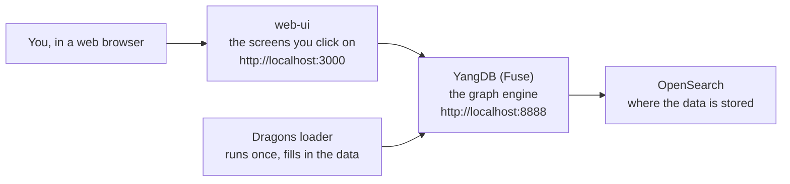

**Words you will see**

| Word | What it means |
|---|---|
| **Graph** | Data stored as *things* and the *connections* between them, like a map of who knows whom. |
| **Entity** (or node) | One thing: a person, a dragon, a horse, a kingdom, a guild. Drawn as a circle. |
| **Relationship** (or edge) | A connection between two entities: a person *owns* a dragon, a dragon *fires on* another dragon. Drawn as a line. |
| **Property** | A detail of an entity or relationship: a dragon's colour, a person's first name. |
| **Ontology** (or schema) | The list of which entities, relationships and properties exist. The "rules" of the data. |
| **Query** | A question you ask the graph, like "which people own a black dragon?" |
| **YangDB / Fuse** | The graph database. *Fuse* is the name of its server. |
| **OpenSearch** | The storage engine Fuse keeps its data in. You never use it directly. |
| **Docker** | A tool that runs programs in ready-made boxes (*containers*), so you don't have to install them one by one. |
| **Docker Compose** | A separate tool that works with Docker. It reads a list of containers from a file (`docker-compose.yml`) and starts, stops or removes them all together. Docker on its own runs one container at a time. |
| **Terminal** | The window where you type commands. On a Mac: **Terminal**. On Windows: **PowerShell**. |

**The Dragons world** is a small made-up world that comes with YangDB:

| Entity | Example properties |
|---|---|
| Person | first name, last name, gender (`MALE` / `FEMALE`), birth date, height |
| Dragon | name, colour (`BLACK`, `RED`, `BLUE`, …), gender, power |
| Horse | name, weight, top speed |
| Kingdom | name, king, queen, funds |
| Guild | name, description, founding date |
| Profession | name, experience, salary |

| Relationship | From | To |
|---|---|---|
| Own | Person | Dragon or Horse |
| Know | Person | Person |
| MemberOf | Person | Guild |
| Fire, Freeze | Dragon | Dragon |
| OriginatedIn | Dragon, Horse or Person | Kingdom |
| RegisteredIn | Guild or Horse | Kingdom |
| SubjectOf | Person | Kingdom |
| HasProfession | Person | Profession |

---

## 2. Install the tools you need

You need three tools: **Docker**, **Docker Compose** and **Git**.

Docker and Docker Compose are two different tools. **Docker** runs containers. **Docker Compose** starts a whole
group of containers described in one file: web-ui's `docker-compose.yml` lists the five that make up this setup.
Every `docker compose ...` command in this guide is Docker Compose.

### Docker and Docker Compose

| Your computer | Install |
|---|---|
| Mac | **Colima**, with Docker and Docker Compose from Homebrew |
| Windows | **Docker Desktop** |
| Linux | **Docker Engine** and the **Compose plugin** |

**Mac: Colima.** A Mac can't run Docker containers directly: they need Linux. Colima runs Docker inside a small
Linux virtual machine, and `docker` and `docker compose` on your Mac talk to it. You install three things with
[Homebrew](https://brew.sh): Colima, the `docker` command, and Docker Compose.

1. If you don't have Homebrew, install it: open Terminal and paste the command shown on **https://brew.sh**. Check
   with `brew --version`.
2. Install Colima, Docker and Docker Compose:
   ```bash
   brew install colima docker docker-compose
   ```
3. Tell Docker where Homebrew put Docker Compose, so that `docker compose` (with a space) works. If you have never
   used Docker on this Mac, this creates the settings file for you:
   ```bash
   mkdir -p ~/.docker
   [ -e ~/.docker/config.json ] || printf '{\n  "cliPluginsExtraDirs": ["%s/lib/docker/cli-plugins"]\n}\n' "$(brew --prefix)" > ~/.docker/config.json
   ```
   If `~/.docker/config.json` already existed, the second line leaves it alone: open it in a text editor (`open -e
   ~/.docker/config.json`) and add this line just after the first `{` (on an Intel Mac, use `/usr/local` instead of
   `/opt/homebrew`):
   ```
   "cliPluginsExtraDirs": ["/opt/homebrew/lib/docker/cli-plugins"],
   ```
4. Start Colima with enough memory (OpenSearch needs the room):
   ```bash
   colima start --cpu 4 --memory 6
   ```
   The first start downloads the virtual machine and takes a few minutes. It ends with *done*. If your Mac has 8 GB
   of memory or less, use `--memory 4`.
5. Check it: `colima status` includes *colima is running*, and `docker context show` says `colima`.

Colima doesn't start by itself after you restart your Mac. Type `colima start` again (it remembers the memory you
gave it), or have it start at login with `brew services start colima`.

**Windows: Docker Desktop.** It contains both Docker and Docker Compose, so there is nothing extra to install.
(Already using Docker Desktop on a Mac? It works too: skip the Colima steps and check its memory as in step 3.)

1. Download it from **https://www.docker.com/products/docker-desktop/** and install it like any other app.
   - **Windows:** the installer may ask to enable *WSL 2*. Say yes and restart if asked.
2. Open **Docker Desktop** and wait until it says it is running (a green status at the bottom left).
3. Give Docker enough memory: in Docker Desktop open **Settings → Resources** and set **Memory** to at least
   **4 GB**. Click **Apply & restart**. (OpenSearch needs the room.)

**Linux: install Docker Engine, then the Compose plugin.** Docker Engine alone does not include Compose.

1. Install Docker Engine for your distribution: **https://docs.docker.com/engine/install/**.
2. Install Docker Compose as a plugin. On Ubuntu or Debian (with Docker's package repository, set up in step 1):
   ```bash
   sudo apt-get update
   sudo apt-get install docker-compose-plugin
   ```
   On Fedora, RHEL or CentOS: `sudo dnf install docker-compose-plugin`. Other systems:
   **https://docs.docker.com/compose/install/linux/**.
3. To run `docker` without `sudo`, follow **https://docs.docker.com/engine/install/linux-postinstall/** (then log
   out and back in).

### Git

- **Mac:** open Terminal and type `git --version`. If it isn't installed, macOS offers to install it; accept. (Or
  `brew install git`.)
- **Windows:** download from **https://git-scm.com/download/win** and install with the default options.

### Check that all three work

Open a terminal (Mac: press `Cmd+Space`, type **Terminal**, press Enter. Windows: press the Windows key, type
**PowerShell**, press Enter) and type each line, pressing Enter after each:

```bash
docker --version
docker compose version
git --version
```

You should see three version numbers, something like:

```
Docker version 29.1.0, build ...
Docker Compose version v2.40.0
git version 2.50.1
```

If one says *command not found*, that tool isn't installed yet: go back to its step.

**If `docker compose version` fails** (for example *'compose' is not a docker command*), Docker is installed but
Docker Compose isn't, or you have the older stand-alone program, spelled with a hyphen. Try:

```bash
docker-compose --version
```

- It says **version 2** or later (for example `Docker Compose version v2.40.0`): that works. Type `docker-compose`
  (with a hyphen) wherever this guide says `docker compose`, for example `docker-compose up -d`.
- It says **version 1** (for example `docker-compose version 1.29.2`) or *command not found*: install Docker Compose
  version 2 as described [above](#docker-and-docker-compose). Version 1 is no longer supported and can't read
  web-ui's `docker-compose.yml`.

---

## 3. Download web-ui

In the same terminal:

```bash
git clone https://github.com/YANG-DB/web-ui.git
cd web-ui
```

The first line downloads web-ui into a folder called `web-ui`; the second moves you into it. **Every command from
now on is typed inside this folder.** If you close the terminal, open a new one and type `cd web-ui` again (or the
full path, for example `cd ~/web-ui`).

---

## 4. Start everything with one command

```bash
docker compose up -d
```

What happens:

1. Docker downloads OpenSearch, YangDB and the small images web-ui is built on (about 2 GB, the first time only).
2. It builds web-ui (2 to 5 minutes, the first time only).
3. It starts OpenSearch, waits until it is healthy, then starts Fuse and waits for it too.
4. The **Dragons loader** fills Fuse with the Dragons world, then stops.

When the command finishes you get your prompt back, and the last lines look like this:

```
 ✔ Container web-ui-opensearch-1      Healthy
 ✔ Container web-ui-fuse-1            Healthy
 ✔ Container web-ui-ui-1              Started
 ✔ Container web-ui-dragons-loader-1  Started
```

### Check that everything is running

```bash
docker compose ps -a
```

```
NAME                      SERVICE          STATUS
web-ui-dragons-loader-1   dragons-loader   Exited (0) 1 minute ago
web-ui-fuse-1             fuse             Up 2 minutes (healthy)
web-ui-mock-1             mock             Up 2 minutes
web-ui-opensearch-1       opensearch       Up 2 minutes (healthy)
web-ui-ui-1               ui               Up 2 minutes
```

- `fuse` and `opensearch` should say **(healthy)**.
- `dragons-loader` should say **Exited (0)**: it ran once and finished. *Exited* with **0** means success.

### Check that the data is in

```bash
docker compose logs dragons-loader
```

```
dragons-loader-1  | Dragons data loaded
```

You can also ask the graph server directly. Open **http://localhost:8888/fuse/health** in your browser:

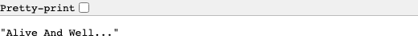

> **Ports already in use?** If something else on your computer already uses port 3000, 8888 or 9200, `docker compose
> up` stops with *port is already allocated*. Pick other ports, for example:
> `UI_PORT=3100 FUSE_PORT=8899 OS_PORT=9201 docker compose up -d` (on Windows PowerShell:
> `$env:UI_PORT=3100; $env:FUSE_PORT=8899; $env:OS_PORT=9201; docker compose up -d`), then use those numbers in the
> addresses below.

---

## 5. Open web-ui

Open **http://localhost:3000** in your browser. You land on the **Research** page:

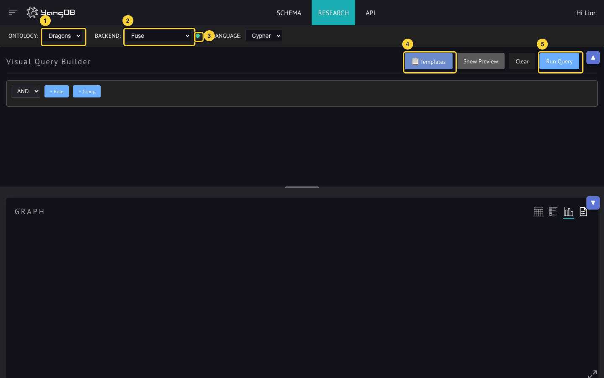

1. **Ontology:** which world you are looking at. *Dragons* is the one we loaded.
2. **Backend:** where the data comes from. **Fuse** means the real graph you just started.
3. **The dot:** green means web-ui can talk to Fuse. Red means it can't (see [section 15](#15-if-something-goes-wrong)).
4. **Templates:** ready-made questions. The easiest way to start.
5. **Run Query:** sends your question to the graph.

The three tabs at the top are **Schema** (the rules of the data), **Research** (asking questions) and **API** (for
developers).

---

## 6. Look at the Dragons schema

Click **SCHEMA** at the top.

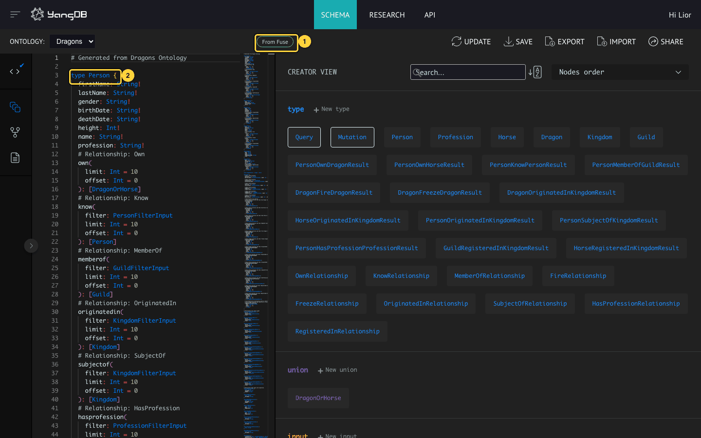

1. **From Fuse** means this is the schema Fuse actually has (not a sample copy).
2. On the left, the schema as text. `type Person { … }` lists everything a person has: `firstName`, `lastName`,
   `gender` and so on. Lines like `own(…): [DragonOrHorse]` are relationships: a person can own dragons or horses.

On the right, every entity and relationship is a box you can click to explore. Nothing you do here changes the data.

> **For the curious:** the same schema, as Fuse stores it, is at
> **http://localhost:8888/fuse/catalog/ontology/Dragons** (it is long JSON text).

Click **RESEARCH** to go back.

---

## 7. Your first query

**Question: which people own a dragon?**

1. Click **📋 Templates**. A list of ready-made questions opens.
2. Find **"Find dragons owned by persons (relationship)"** and click **USE ME** next to it.

   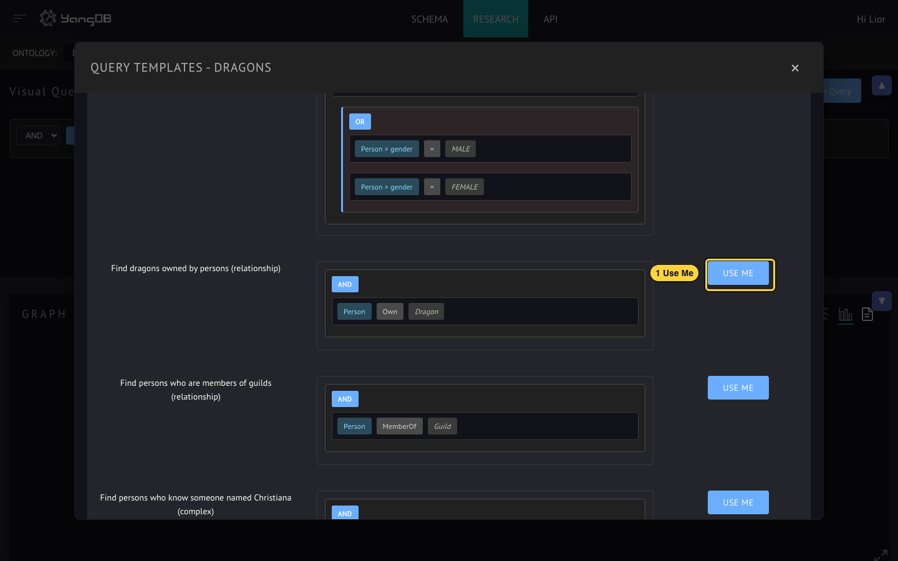

3. The question appears in the builder as one line, **Person · Own · Dragon**. Click **Run Query**.

   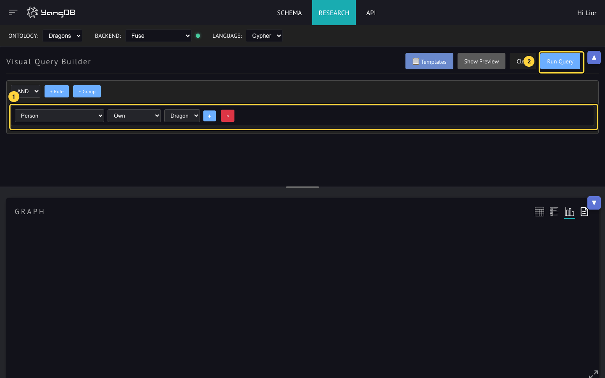

4. After a second or two the answer appears as a graph:

   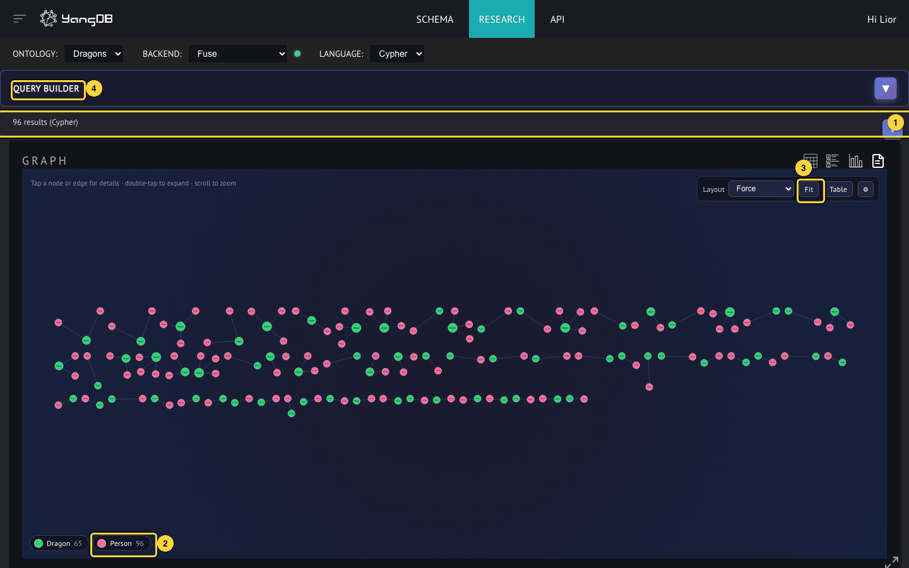

   1. **96 results (Cypher)**: 96 "person owns dragon" pairs were found.
   2. **The legend:** 96 people (pink) and 65 dragons (green). Fewer dragons than people, so some dragons have
      more than one owner.
   3. **Fit** brings the whole graph back into view if you get lost.
   4. **Query Builder** is folded away to make room. Click the ▼ on the right to open it again.

> **Tip:** the ▲ / ▼ buttons on the right fold the query builder and the results away and back.

---

## 8. Read the graph

Zoomed out, you see the shape of the answer. **Scroll with your mouse wheel (or pinch on a trackpad) to zoom in**,
and drag the background to move around:

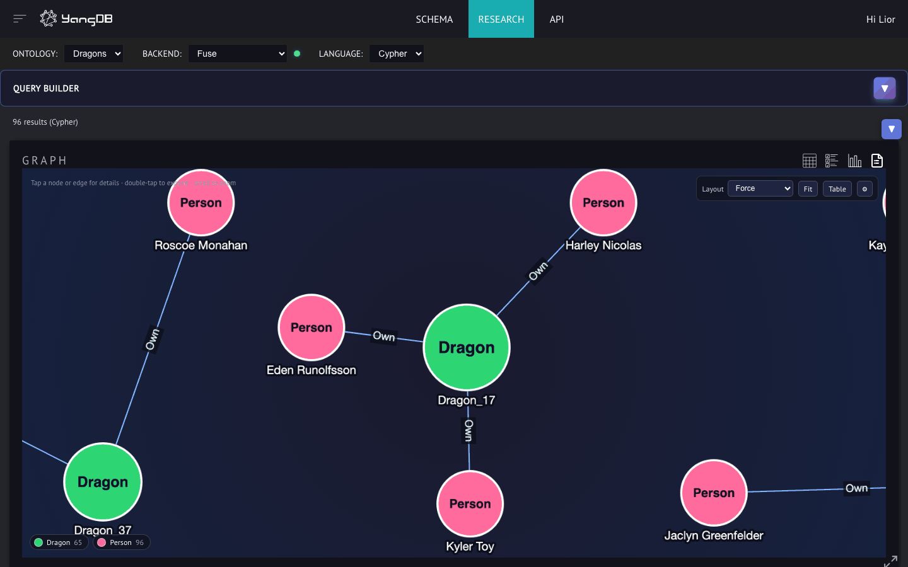

- **Colour = type**, and the type is also written inside each circle: pink **Person**, green **Dragon**.
- **The name is under the circle.** Some dragons in this world have no name, so they show their ID instead, like
  `Dragon_17`.
- **Bigger circle = more connections.** `Dragon_17` is big because three people own it.
- **Lines are relationships**, labelled when you zoom in: here **Own**.
- **Click a type in the legend** (bottom left) to hide it or show it again.
- **Layout** (top right) arranges the circles differently: try **Concentric** or **Grid**.

---

## 9. Look at one dragon or person

**Click any circle.** A panel opens on the right with everything about it:

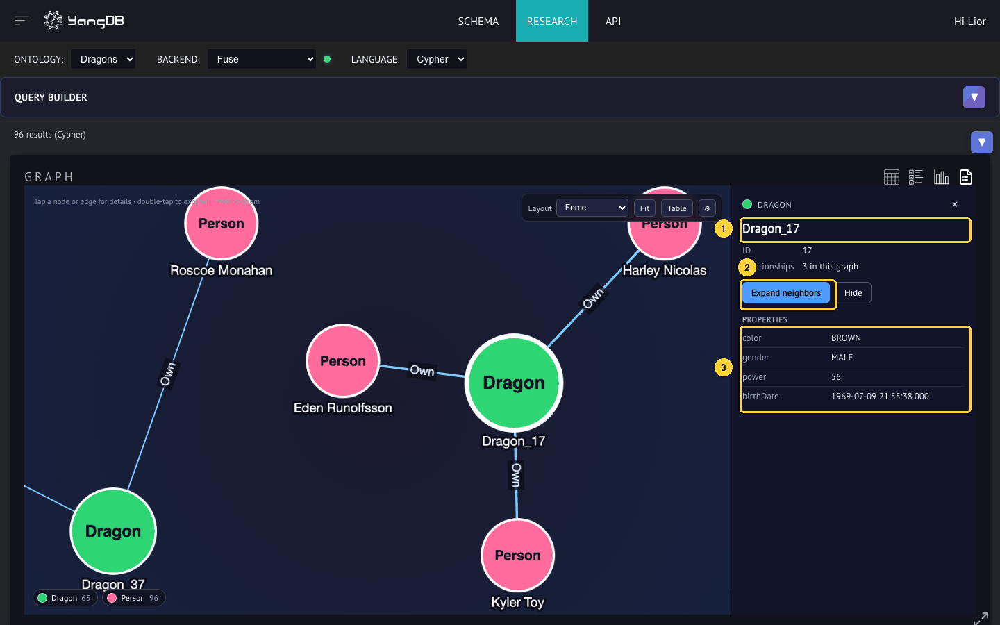

1. Its name (or ID), type, and how many relationships it has in this graph.
2. **Expand neighbors** brings in everything connected to it in the whole database, not just in your answer. For a
   dragon: the kingdom it comes from and the dragons it fired on (or that fired on it). Click again (**Collapse neighbors**) to remove them.
   (Double-clicking a circle does the same.)
3. All its properties. This dragon is brown, male, has power 56 and was born in 1969.

**Click a line** to see that relationship instead: who it connects and since when. Close the panel with **×**, the
**Esc** key, or a click on an empty part of the graph. **Hide** removes the selected circle from view; **Show hidden**
in the graph toolbar brings it back.

---

## 10. See the results as a table

Click **Table** in the graph toolbar:

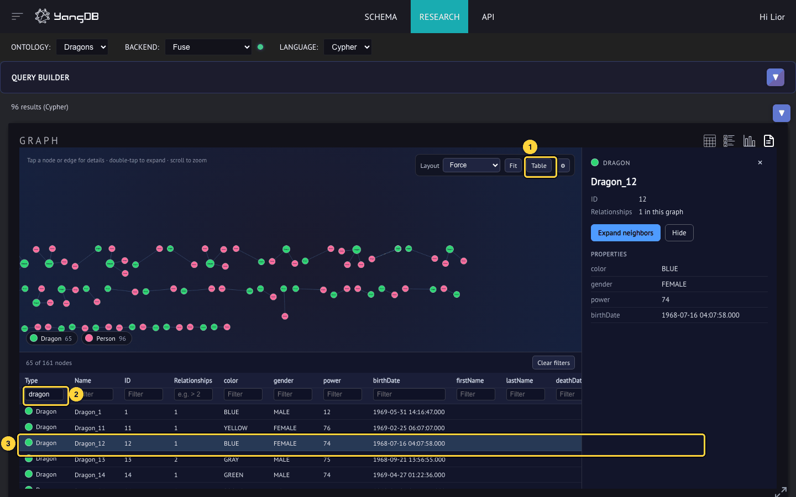

1. **Table** shows or hides the list under the graph.
2. **Each column has a filter box.** Typing `dragon` under *Type* keeps only the dragons (65 of 161). Under
   *Relationships* you can type `> 2` to find the most connected ones.
3. **Click a row** and that circle is selected in the graph, with its details on the right. It works the other way
   too: click a circle and its row lights up.

Click **Table** again to hide it.

---

## 11. Build your own query

**Question: which people own a *black* dragon?**

1. Open the query builder (the ▼ at the right end of the **QUERY BUILDER** bar) and click **Clear**.
2. Click **+ Rule**. A line appears that already reads **Person · Own · Dragon**: exactly what we want.
3. Click **+ Rule** again for a second line. In it, choose:
   - first box: **Dragon > color**
   - second box: **=**
   - third box: type **BLACK** (in capitals: the data uses capitals, and `black` finds nothing)
4. Click **Run Query**.

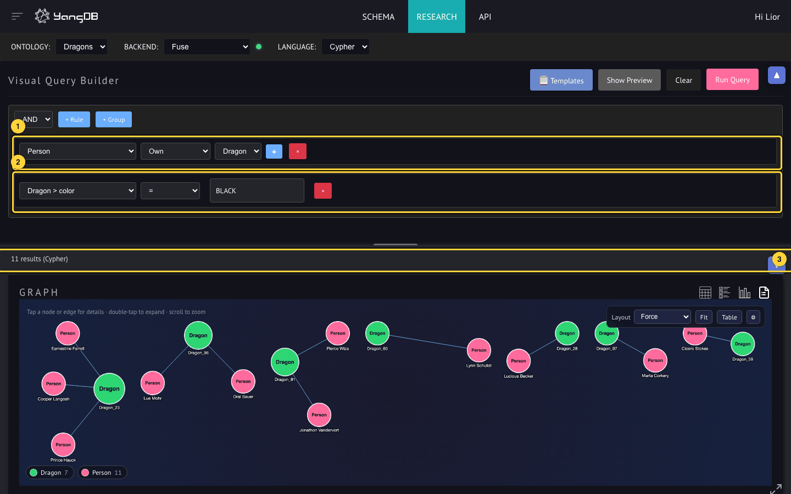

1. The first rule: a person owns a dragon.
2. The second rule: that dragon's colour is BLACK.
3. **11 results**: eleven people own a black dragon.

Rules are combined with **AND**: every rule must be true. Change the **AND** at the top left to **OR** if any one
rule is enough. **+ Group** makes a sub-group with its own AND/OR.

---

## 12. Search inside text: Cypher and V1

**Question: of those people, whose first name contains the letter "e"?**

1. Click **+ Rule** and set it to **Person > firstName · contains · e**.
2. Click **Run Query**.

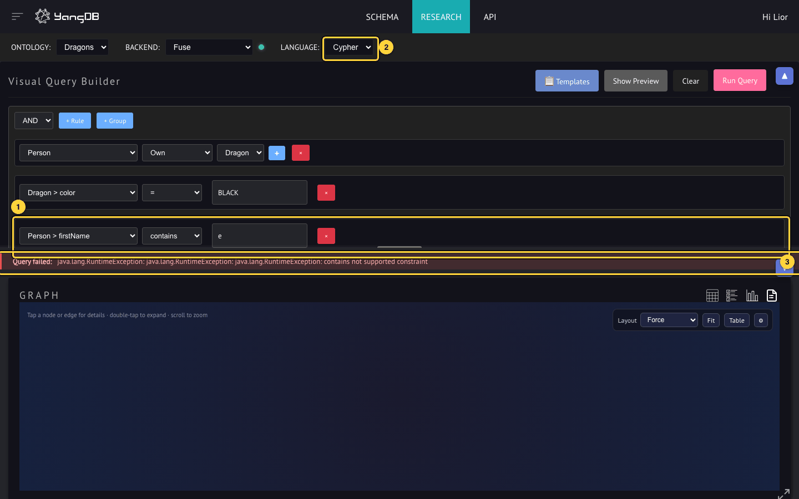

1. The new rule.
2. **Language: Cypher**: the question is sent to Fuse in a query language called *Cypher*.
3. **Query failed: … contains not supported constraint**: Fuse's Cypher can't search inside text. Nothing is wrong
   with your question.

Fuse has a second language, **V1**, which can.

Now change **Language** to **V1** and click **Run Query** again:

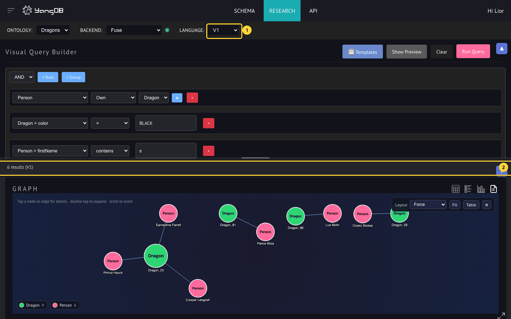

1. **Language: V1**.
2. **6 results**: Prince, Cooper, Earnestine, Pierce, Lue and Cicero, each with a black dragon.

**Which language should I use?** Start with **Cypher**. If you get an error, try **V1**. Templates work in both.
V1 can't combine an OR across two different kinds of thing (for example "the person is male OR the dragon is red");
in that case web-ui tells you, and Cypher is the one to use.

**Curious what is sent?** Click **Show Preview** and choose **V1 (Fuse)** or **Cypher (Fuse)**:

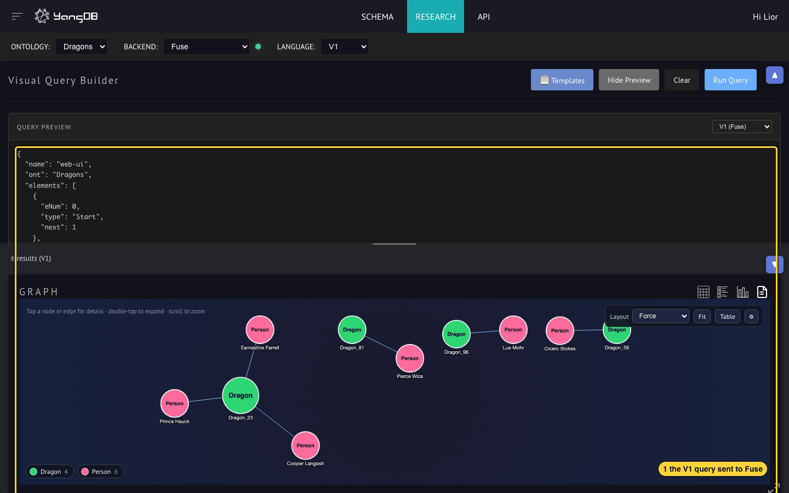

---

## 13. Get more results

Fuse sends answers in pages of 100. Use the template **"Find dragons with specific color"** (black dragons) and run
it:

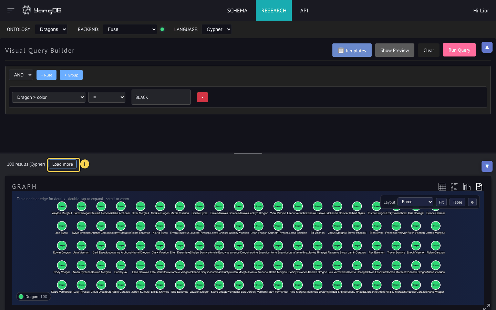

1. **100 results** and a **Load more** button: there are more. Click it and the next page is added. The status line
   becomes **121 results**, and the button disappears because there are no more.

---

## 14. Stop, restart, remove

All of these are typed in the `web-ui` folder:

| To | Type | What happens to the data |
|---|---|---|
| Stop everything (to free memory) | `docker compose stop` | kept |
| Start again later | `docker compose start` | kept; open http://localhost:3000 again |
| Remove everything | `docker compose down` | **deleted** |
| Start fresh after removing | `docker compose up -d` | the loader fills the Dragons world in again |

**With Colima (Mac):** `colima stop` stops Docker itself and frees all its memory (the data is kept). Later, `colima
start`, then `docker compose start`.

**With Docker Desktop:** if Docker Desktop is closed, the containers stop too. Open Docker Desktop, then `docker
compose start`.

---

## 15. If something goes wrong

| What you see | What to do |
|---|---|
| `docker: command not found` | Docker isn't installed (Mac: `brew install colima docker docker-compose`), or Docker Desktop isn't running. Install it ([section 2](#2-install-the-tools-you-need)) and open it. |
| `'compose' is not a docker command`, or `unknown shorthand flag: 'd' in -d` | Docker Compose isn't installed. See [Check that all three work](#check-that-all-three-work). |
| `docker-compose: command not found` | You typed the hyphen spelling, which is only for the older stand-alone program. Type `docker compose` (with a space) instead. |
| `Cannot connect to the Docker daemon` | Docker isn't running. Docker Desktop: open it and wait for the green status. Colima: type `colima start`. |
| Colima: `docker compose version` says *'compose' is not a docker command*, but `docker-compose --version` works | Docker can't find the Compose plugin. Do step 3 of [Colima](#docker-and-docker-compose) (`cliPluginsExtraDirs`). |
| Colima: containers stop with **Exited (137)**, or OpenSearch keeps restarting | The Colima virtual machine has too little memory. `colima stop`, then `colima start --memory 6`. |
| `port is already allocated` | Another program uses that port. Use other ports, as in [section 4](#4-start-everything-with-one-command). |
| `docker compose up` waits a long time at *opensearch Waiting* and then fails | Docker has too little memory. Give it 4 GB or more (Colima: `colima stop`, then `colima start --memory 6`; Docker Desktop: [section 2](#2-install-the-tools-you-need)), then `docker compose down` and `docker compose up -d`. |
| `dragons-loader` says **Exited (1)** | The data didn't load. Type `docker compose up -d dragons-loader` to run it again, then `docker compose logs dragons-loader`. |
| http://localhost:3000 doesn't open | Wait a minute after `up` finishes, then reload. Check `docker compose ps`: `ui` should be *Up*. |
| The dot next to Backend is **red** and you see a yellow notice about mock data | web-ui can't reach Fuse. Check `docker compose ps`: `fuse` should be *healthy*. Then pick **Fuse** in **Backend** again, or reload the page. |
| A query finds **0 results** | Values are case-sensitive: `BLACK`, not `black`; `MALE`, not `male`. And not every name exists (there is no "George"). |
| **Query failed: … not supported** | Try **Language: V1** ([section 12](#12-search-inside-text-cypher-and-v1)). |
| **Query failed: … No Ontology entity for value[…]** | A type name is misspelled. Pick types from the boxes rather than typing them. |
| **Query failed: … zip file closed** | Two queries reached Fuse at the same moment. Click **Run Query** again. |

Still stuck? `docker compose logs fuse` shows what the graph server is doing; include its last lines if you ask for
help.

---

## 16. Where to go next

- **Try the other templates**, and change their values: other dragon colours (`RED`, `BLUE`, `GREEN`, `GRAY`,
  `BROWN`, `WHITE`, …), other relationships (Know, MemberOf, Fire).
- **The Dragons tutorial for developers**, [DRAGONS.md](DRAGONS.md): the same world over plain HTTP (curl), how
  queries look in Cypher and V1, and the automated checks.
- **Changing web-ui's code?** Run it from source instead of Docker: install Node.js 20+ and Yarn, then `yarn` and
  `yarn start` in the `web-ui` folder (keep Fuse running with `docker compose up -d fuse dragons-loader`). See the
  [README](../../README.md).
